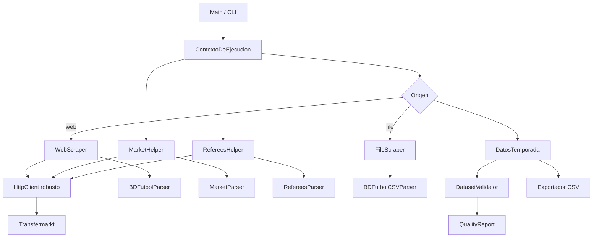

# Plan de implantación: robustez HTTP, parsers, calidad, tests y eliminación del estado global

## Objetivo

Ejecutar los cinco primeros puntos priorizados de [`TODOS.md`](../TODOS.md:1):

1. Capa HTTP robusta.
2. Parsers independientes con validación.
3. Validación de calidad del dataset.
4. Tests mínimos de regresión (incluyendo scraping real contra BDFutbol/Transfermarkt).
5. Eliminación del estado global mutable.

## Estado actual (diagnóstico)

- Las peticiones HTTP están dispersas y sin control en [`WebScraper.py`](src/football_dataset/WebScraper.py:15), [`MarketHelper.py`](src/football_dataset/MarketHelper.py:35) y [`RefereesHelper.py`](src/football_dataset/RefereesHelper.py:53): sin `timeout`, sin reintentos, sin rate limiting y sin gestión de 403/404/429.
- El parseado está acoplado a los scrapers, sin validación de estructura ni errores descriptivos.
- No existe validación de calidad del dataset (duplicados, equipos desconocidos, marcadores/fechas/jornadas inválidas, conteos esperados).
- Todo el estado mutable vive en [`UtilsAndGlobals.py`](src/football_dataset/UtilsAndGlobals.py:10): contadores (`CURRENT_MATCH_ID`, `CURRENT_TEAM_ID`), registros (`TEAM_NAMES_TO_ID`, `IDs_TO_TEAM`, `ALL_SEASONS_INFO`), flags de configuración (`loadFromFile`, `loadMarket`, `loadReferees`) y proxies de helpers.
- No existe suite de tests ni configuración de proyecto para ejecutarlos.

## Arquitectura objetivo

### Principios de diseño

1. **Inyección de dependencias**: cada componente recibe sus colaboradores por constructor; nada lee module-level globals.
2. **Contexto de ejecución**: un único objeto `ContextoDeEjecucion` agrupa configuración, registros y contadores y se pasa explícitamente.
3. **Clientes/parsers separados de la lógica de negocio**: HTTP, parseado y validación son capas independientes probables por separado.
4. **Errores tipados y descriptivos**: excepciones propias (`HttpError`, `ParserError`, `DatasetValidationError`) con mensaje accionable.
5. **Fixture first**: los tests unitarios usan HTML/CSV fijos; los de integración hacen scraping real y se marcan para poder excluirlos por defecto.

## Detalle de los cinco bloques de trabajo

### Bloque 1 — Capa HTTP robusta

Crear [`src/football_dataset/http_client.py`](src/football_dataset/http_client.py:1) con una clase `HttpClient` que envuelve `requests.Session`:

- `timeout` obligatorio (conexión/lectura), configurable.
- Cabecera `User-Agent` común y configurable.
- Reintentos con *backoff* exponencial para errores transitorios (timeouts, `ConnectionError`, `5xx`, `429`).
- Gestión explícita de códigos: `403`, `404`, `429` con excepciones `HttpError` tipadas y mensaje claro.
- *Rate limiting*: pausa mínima entre peticiones (configurable), para respetar las fuentes.
- Método único `get(url, params=None)` reutilizado por todos los scrapers.
- Soporte de inyección de un *adapter* de `requests` o de respuestas `mock` para testear sin red.

**Impactados**: [`WebScraper.py`](src/football_dataset/WebScraper.py:12), [`MarketHelper.py`](src/football_dataset/MarketHelper.py:31), [`RefereesHelper.py`](src/football_dataset/RefereesHelper.py:47).

### Bloque 2 — Parsers independientes con validación

Crear un paquete [`src/football_dataset/parsers/`](src/football_dataset/parsers) con parsers puros (entrada: texto/HTML; salida: estructuras de datos limitadas):

- [`parsers/errors.py`](src/football_dataset/parsers/errors.py:1): `ParserError` y `ValidationError`.
- [`parsers/bdfutbol_parser.py`](src/football_dataset/parsers/bdfutbol_parser.py:1): extrae equipos (`SE[...]=`) y partidos (`SP[...].push(...)`) del HTML de BDFutbol. Valida que existan los bloques esperados, que el JSON embebido sea parseable y que los campos obligatorios (`d`, `a1`, `a2`, `g1`, `g2`) estén presentes.
- [`parsers/csv_parser.py`](src/football_dataset/parsers/csv_parser.py:1): carga y valida filas del CSV (`FileScraper` actual).
- [`parsers/transfermarkt_market_parser.py`](src/football_dataset/parsers/transfermarkt_market_parser.py:1): parses de fechas de mercado y valores por equipo.
- [`parsers/transfermarkt_referees_parser.py`](src/football_dataset/parsers/transfermarkt_referees_parser.py:1): parses de listado de árbitros y de partidos de cada árbitro.
- Modelos de salida en [`src/football_dataset/models.py`](src/football_dataset/models.py:1): `RawTeam`, `RawMatch`, `MarketValue`, `RefereeMatch`.

Cada parser debe lanzar `ParserError` con mensajes como *"No se encontró el bloque 'resultats' de BDFutbol"* o *"El JSON del partido no contiene el campo 'g1'"*, en lugar de fallar con `NoneType`/`KeyError`.

**Impactados**: [`WebScraper.py`](src/football_dataset/WebScraper.py:18), [`FileScraper.py`](src/football_dataset/FileScraper.py:10), [`MarketHelper.py`](src/football_dataset/MarketHelper.py:31), [`RefereesHelper.py`](src/football_dataset/RefereesHelper.py:47).

### Bloque 3 — Validación de calidad del dataset

Crear [`src/football_dataset/validation.py`](src/football_dataset/validation.py:1):

- `DatasetValidator` con métodos para, por temporada/división:
  - Detectar partidos duplicados (misma clave `jornada + local + visitante` o mismo `idPartido`).
  - Detectar equipos desconocidos o nombres sin normalizar (sin ID global).
  - Validar marcadores (`golesLocal`, `golesVisitante`, `golDiff` coherente y no negativos), fechas (`YYYY-MM-DD`, dentro del rango de la temporada) y jornadas (enteros positivos, dentro del rango esperado).
  - Validar número esperado de equipos y partidos por temporada (`numJornadas = 2*(n-1)`; total `n*(n-1)`).
- `QualityReport` (dataclass) con listas de `issues` (severidad, tipo, mensaje, contexto) y contadores.
- Integrar la validación al final del procesamiento, antes de guardar el CSV, emitiendo el informe por logging (WARNING/ERROR según severidad) y abortando si se supera un umbral configurable.

**Impactados**: [`DatosTemporada.py`](src/football_dataset/DatosTemporada.py:35), [`Main.py`](src/football_dataset/Main.py:249).

### Bloque 4 — Tests mínimos de regresión

Configurar `pytest` y crear `tests/`:

- [`pyproject.toml`](pyproject.toml:1) (o `pytest.ini`) con marcadores `unit` e `integration`.
- [`tests/conftest.py`](tests/conftest.py:1): fixtures de contexto, respuestas HTTP simuladas y HTML/CSV de ejemplo.
- [`tests/fixtures/`](tests/fixtures): fragmentos HTML de BDFutbol y Transfermarkt + CSV.
- Unitarios (offline):
  - `Equipo` y `Partido` (constructor y serialización).
  - Normalización/resolución de nombres de equipos.
  - Parsers con fixtures fijos.
  - Cálculo de clasificación acumulada.
  - Serialización/carga de cachés JSON.
- Integración (scraping real, marcados `@pytest.mark.integration`):
  - `WebScraper` contra una temporada real conocida (BDFutbol).
  - `MarketHelper` y `RefereesHelper` contra Transfermarkt.
  - Controlados por variable de entorno o flag CLI para excluirlos por defecto en CI, pero ejecutables bajo demanda.

**Impactados**: ninguno existente; archivos nuevos + [`requirements.txt`](requirements.txt:1) (añadir `pytest`, `pytest-mock`/`responses` si procede).

### Bloque 5 — Eliminación del estado global mutable

Crear [`src/football_dataset/context.py`](src/football_dataset/context.py:1) con `ContextoDeEjecucion` (dataclass o clase):

- Configuración: `source`, `enable_market`, `enable_referees`, rutas (`output_path`, `input_path`, `market_path`, `referees_path`).
- Registro de equipos: `team_names_to_id`, `ids_to_team`, `current_team_id`.
- Contador de partidos: `current_match_id`.
- Registro de temporadas: `all_seasons_info`.
- `get_or_create_team(nombre)`, `next_match_id()`, helpers de normalización sin estado.
- Referencias inyectadas a `market_helper` y `referees_helper`.

Refactorizar para que:

- `DatosTemporada`, `WebScraper`, `FileScraper`, `MarketHelper` y `RefereesHelper` reciban el contexto (o sus dependencias) por constructor.
- [`UtilsAndGlobals.py`](src/football_dataset/UtilsAndGlobals.py:1) quede como módulo de utilidades puras (normalización o excepciones), sin estado mutable ni *singletons* globales; los *singletons* de helpers pasan a instancias creadas en [`Main.py`](src/football_dataset/Main.py:173) e inyectadas.
- [`Main.py`](src/football_dataset/Main.py:249) construya un `ContextoDeEjecucion` por ejecución y lo pase explícitamente, garantizando que una ejecución no contamine la siguiente.

## Orden de ejecución recomendado

1. Crear `HttpClient` + excepciones HTTP (base para todo lo demás).
2. Extraer parsers y modelos (puros, sin E/S).
3. Introducir `ContextoDeEjecucion` y desacoplar estado global.
4. Refactorizar scrapers/helpers para usar HTTP client + parsers + contexto.
5. Implementar `DatasetValidator`/`QualityReport` e integrarlo en `Main`.
6. Añadir infraestructura de pytest + tests unitarios y de integración.
7. Actualizar [`README.md`](README.md:1) y [`requirements.txt`](requirements.txt:1).

## Criterios de aceptación

- Todos los scrapers comparten el mismo `HttpClient` con timeout, reintentos y rate limiting.
- Ningún parser lanza `KeyError`/`NoneType` ante HTML cambiado: lanza `ParserError` descriptivo.
- El dataset se valida antes de guardarse y emite un informe de calidad.
- `pytest` ejecuta una suite unitaria verde sin red; los tests de integración (scraping real) se ejecutan bajo demanda.
- No quedan variables globales mutables de estado en el flujo de ejecución.
- Una ejecución puede llamarse dos veces sin contaminación de estado entre llamadas.