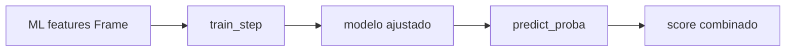

# Plan: integración y comparación de estrategias 1X2 (bloque #24)

## Objetivo

Permitir que el clasificador multiclase directo, el de dos etapas
([`staged.py`](../src/football_ml/staged.py:1)) y el de goles Poisson
([`poisson.py`](../src/football_ml/poisson.py:1)) se evalúen con el **mismo**
walk-forward cronológico y el **mismo** score combinado, para decidir cuál
merece optimización fina y despliegue.

## Decisión de datos

Poisson necesita los goles como target, pero el artefacto
[`dataset_ml.csv`](../data/dataset_ml.csv) los elimina. Se acuerda:

- Añadir `golesLocal` y `golesVisitante` a `ML_COLUMNS` como columnas
  **exclusivamente de target**, no de feature.
- Excluirlas del preprocesado (imputación/escalado) igual que `resultado1X2`.
- No modificar el CSV fuente v3 ni el metadato de esquema persistente.

## Protocolo de estrategia

Cada estrategia expone un `train_step(train, params) -> modelo_ajustado` que:

1. Construye su modelo (multiclase / staged / poisson).
2. Extrae internamente el target que necesita:
   - multiclase y staged: `resultado1X2`.
   - poisson: `golesLocal` + `golesVisitante`.
3. Entrena y devuelve un objeto con `predict(X)` y `predict_proba(X)` que
   devuelve probabilidades `1X2` normalizadas.

## Cambios previstos

1. `ml_features.py`: añadir `golesLocal` y `golesVisitante` a `ML_COLUMNS` y
   propagar sus valores en la transformación.
2. `preprocessing.py`: incluir ambas columnas en `EXCLUDED_COLUMNS`.
3. `snapshots.py`: para fixtures futuras, marcar goles como `-1` (desconocido).
4. `walk_forward.py`: generalizar `model_factory` a `train_step(train, params)`
   para no asumir `target_series` en el bucle.
5. `strategies.py`: fábricas `train_step` de las tres estrategias.
6. `__main__.py`: subcomando `compare` que evalúa las tres sobre el mismo
   frame y muestra una tabla comparativa.
7. `tuning.py`: minimos cambios para seguir funcionando con la nueva firma.

## Compatibilidad

- `train_model()` y el subcomando `train` siguen intactos; el walk-forward de
  `tune` se adapta con un `train_step` equivalente al anterior.
- Los tests existentes de walk-forward y tuning deben seguir verdes.

## Criterios de aceptación

- Las tres estrategias producen probabilidades 1X2 que suman 1.
- La comparación usa idénticas rondas, cortes y score combinado.
- Los goles no se tratan como feature en ninguna estrategia.
- Ninguna estrategia usa información posterior a la ronda que predice.
- La suite y Ruff permanecen verdes.