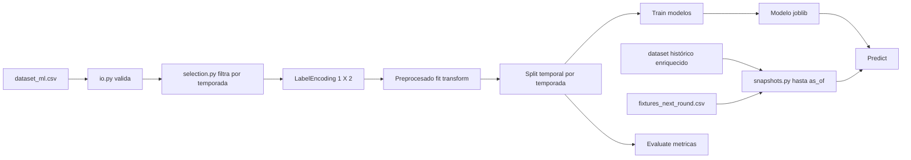

# Plan: pipeline de aprendizaje automático 1X2 (bloque #20)

## Objetivo

Construir un paquete `src/football_ml/` independiente que consuma el artefacto
[`dataset_ml.csv`](../README.md:88) generado por [`ml_features.py`](../src/football_dataset/ml_features.py:1)
y permita predecir el resultado `1X2` de un partido de fútbol visto desde la
perspectiva del equipo local.

Alcance de esta primera versión (confirmado):

- Filtrado temporal por temporada (la serie es temporal: lo antiguo no informa).
- Carga y validación del dataset ML.
- Preprocesado reproducible (`fit`/`transform`).
- División temporal por temporada sin fuga de información.
- Entrenamiento y comparación de modelos (baseline + supervisados).
- Evaluación con métricas orientadas a clasificación multiclase.
- Predicción desde un modelo persistido.

### Requisitos de diseño

- **No contaminar la fuente de verdad**: el dataset fuente v3 y `dataset_ml.csv`
  no se modifican. El modelado es un consumidor.
- **Tratar los datos como serie temporal**: el orden cronológico manda. Las
  temporadas antiguas se pueden descartar y las recientes se reservan como
  holdout. Nunca se baraja el tiempo.
- **Caso operativo principal**: en una fecha de ejecución se conocen los
  partidos finalizados hasta el corte y el calendario de la próxima jornada,
  pero no sus goles ni `resultado1X2`. El sistema debe construir features para
  esas fixtures futuras y devolver una predicción, no buscar filas futuras ya
  etiquetadas dentro del CSV histórico.
- **Separar histórico y fixtures**: `dataset_ml.csv` solo contiene ejemplos
  supervisados ya finalizados. Para operar se necesita un fichero adicional de
  fixtures futuros, sin goles ni etiqueta, y un constructor de snapshots que
  use el dataset histórico enriquecido como fuente de estado previo.
- **Dependencias aisladas**: `pandas` y `scikit-learn` viven en un
  `requirements-ml.txt` separado del [`requirements.txt`](../requirements.txt:1)
  del generador. El entorno de scraping no se infla.
- **Determinismo**: seed fija en todo el pipeline; tests offline.
- **Sin fuga temporal**: la división de datos respeta el orden cronológico por
  `temporada`; nunca se barajan temporadas.
- **Estilo coherente con el proyecto**: `src`-layout, `python -m`, Ruff/mypy
  progresivo y suite pytest determinista.

## Filtrado temporal (recencia)

El histórico empieza en `1970-71`, pero el fútbol actual y las reglas de
mercado cambian, así que las temporadas antiguas aportan ruido. Antes de
preprocesar, [`selection.py`](#3-selectionpy) recorta la serie según criterios
explícitos y reproducibles:

1. **Corte por temporada mínima** (`--min-season`): conserva solo partidos con
   `temporada >= min_season`. Ej.: `2000-01` descarta todo lo anterior.
2. **Ventana de temporadas recientes** (`--last-seasons N`): conserva solo las
   últimas `N` temporadas completas presentes en el CSV, útil cuando la
   recencia importa más que una fecha fija.

Ambos filtros se aplican sobre la clave `temporada`; la clave numérica de orden
se obtiene del año de inicio (`int(temporada.split("-")[0])`), por lo que
`2021-22` resulta `2021`. El filtrado ocurre **antes** del split y del
preprocesado, se registra en los metadatos del modelo (ventana usada) y es
comprobable en tests: una fila anterior al corte jamás aparece en train ni en
validación.

Valores por defecto (documentados, configurables):

- `--min-season` por defecto `2000-01` (suficiente moderna y sin ser arbitraria).
- `--last-seasons` desactivado por defecto; si se indica, tiene prioridad sobre
  `--min-season` porque define la ventana de forma dinámica.

## Esquema de entrada

La entrada es `dataset_ml.csv` con metadato `# football_dataset_ml=1` y las
columnas de [`ML_COLUMNS`](../src/football_dataset/ml_features.py:23):

| Rol | Columnas |
|---|---|
| Etiqueta | `resultado1X2` (`1`, `X`, `2`) |
| Contexto temporal | `temporada`, `jornada` |
| Identidad de equipos | `localId`, `visitanteId` |
| Características numéricas | `division`, `diferenciaPuntos`, `diferenciaPosicion`, `diferenciaGolesNeta`, `rachaLocal`, `rachaVisitante`, `h2hMatches`, `h2hBalance`, `campeonDecidido`, `descensoConfirmadoLocal`, `descensoConfirmadoVisitante`, `presionLocal`, `presionVisitante`, `rivalidad`, `distanciaKm`, `diferenciaValorMercado`, `ratioValorMercado` |

### Semántica de valores ausentes (crítica)

El marcador `-1` no es universalmente "ausente". Se distinguen dos casos:

1. **`-1` = ausencia explícita** (documentado en el proyecto): `distanciaKm`,
   `diferenciaValorMercado` y `ratioValorMercado`. En estas columnas se imputa.
2. **`-1` = valor real**: `diferenciaPuntos`, `diferenciaPosicion`,
   `diferenciaGolesNeta` y `h2hBalance` representan diferencias que pueden ser
   legítimamente `-1`. No se imputan.

La imputación de ausencias se implementa **solo** para el caso 1, con
`median` por división y una columna indicadora binaria `es_ausente_<campo>`
cuando el campo presente ausencias, para no perder la señal del "no registrado".

## Predicción de la próxima jornada

El `dataset_ml.csv` actual es un histórico supervisado: sus 43.884 filas tienen
resultado conocido. No es suficiente para predecir directamente el 14/10/2026,
porque no contiene partidos futuros de la temporada 2026-27 ni una fila sin
etiqueta para cada fixture.

Se introduce un segundo artefacto, `fixtures_next_round.csv`, con una fila por
partido futuro y como mínimo:

- `division`, `temporada`, `jornada`, `matchDate`;
- `localId`, `visitanteId` (y nombres opcionales para mostrar resultados);
- valores de mercado/árbitro solo si están disponibles antes del inicio.

Este archivo **no lleva `resultado1X2`, goles ni estadísticas postpartido**.
El fichero histórico que alimenta el entrenamiento debe cortarse además por
`matchDate <= as_of`: aunque una temporada completa esté en el CSV, no se puede
usar ningún partido posterior a la fecha de ejecución. Para predecir el
14/10/2026, el histórico de entrenamiento termina el 13/10/2026 y las fixtures
objetivo pertenecen a una jornada posterior aún no disputada.
Antes de predecir, el sistema debe generar las features de cada fixture a partir
de los partidos finalizados anteriores al corte. Es decir, no se copian las
features de una fila histórica con el mismo equipo/jornada: se reconstruye el
snapshot actual de clasificación, forma, H2H y contexto competitivo.

El modo recomendado será:

```text
python -m src.football_ml next-round \\
  --history data/dataset_historico_1970_2025_enriquecido.csv \\
  --fixtures data/fixtures_next_round.csv \\
  --model data/model.joblib \\
  --as-of 2026-10-14 \\
  --last-seasons 10 \\
  --output data/predicciones_jornada.csv
```

El modelo se entrena únicamente con partidos cuya fecha sea anterior al corte
operativo y la salida conserva la identidad del fixture, junto con `P(1)`,
`P(X)`, `P(2)` y la clase elegida. Si la jornada futura no está disponible, no
es posible producir predicciones fiables solo con `dataset_ml.csv`: primero hay
que obtener el calendario y construir sus snapshots prepartido.

## Estructura propuesta

```text
src/
  football_ml/
    __init__.py
    __main__.py       # CLI con subcomandos: train, evaluate, predict, next-round
    io.py             # carga y validación del CSV ML
    fixtures.py       # carga/validación de fixtures futuras sin etiqueta
    snapshots.py      # features prepartido desde histórico hasta as_of
    selection.py      # filtrado temporal por temporada (recencia)
    preprocessing.py  # codificación de objetivo, imputación y escalado
    split.py          # división temporal sin fuga
    baseline.py       # modelos de referencia sin entrenamiento
    models.py         # clasificadores supervisados
    train.py          # orquestación y persistencia del modelo
    evaluate.py       # métricas, matriz de confusión e informe por temporada
    predict.py        # inferencia desde modelo persistido
    next_round.py     # entrenamiento opcional y predicción de jornada futura
requirements-ml.txt   # pandas, scikit-learn, joblib
tests/
  test_ml_pipeline.py
```

## Flujo de datos



## Detalle de componentes

### 1. `io.py`

- Lee el CSV ML y valida:
  - Metadato `# football_dataset_ml=1`.
  - Presencia de las columnas obligatorias (`.ML_COLUMNS`).
  - Valores de la etiqueta dentro de `{1, X, 2}`.
- Devuelve un `pandas.DataFrame` con tipos inferidos y `temporada` ordenable.
- Errores tipados con mensaje descriptivo (como [`ParserError`](../src/football_dataset/parsers/errors.py:1)).

### 2. `selection.py`

- Parsea la clave temporal de `temporada` (`int(temporada.split("-")[0])`).
- Expone `filter_by_min_season(df, min_season)` y
  `filter_last_seasons(df, n_seasons)`.
- Devuelve un `DataFrame` filtrado y un resumen (`total`, `descartadas`,
  `conservadas`) para auditar el recorte.
- Se ejecuta siempre antes del split; el corte elegido queda guardado en los
  metadatos del modelo.
- El corte temporal tiene dos significados distintos: `as_of` limita el
  histórico que puede usarse para entrenar; `last_seasons` reduce la antigüedad
  dentro de ese histórico. No debe confundirse con el calendario de fixtures.

### 3. `preprocessing.py`

- **Codificación del objetivo**: `1 -> 0`, `X -> 1`, `2 -> 2`, conservando
  `classes_ = ["1", "X", "2"]` para interpretar la salida.
- **Selección de features**: se excluyen del modelado `localId`, `visitanteId` y
  `temporada` (se usan solo para split/trazabilidad). `division`, `rivalidad`,
  `campeonDecidido`, descensos y presiones se tratan como categóricas ordinales.
- **Imputación** (`SimpleImputer`): mediana por división para `distanciaKm`,
  `diferenciaValorMercado` y `ratioValorMercado`; indicadoras de ausencia.
- **Escalado** (`StandardScaler`) sobre las numéricas; se encapsula en un
  `sklearn.pipeline.Pipeline` con `fit`/`transform` separados.

### 4. `split.py`

- Ordena por `temporada` y separa cronológicamente:
  - `train`: temporadas antiguas.
  - `validation`: temporadas intermedias.
  - `test`: temporadas recientes (holdout final).
- Soporta `TimeSeriesSplit` para validación cruzada temporal sobre el tramo de
  entrenamiento.
- Función de propósito general `temporal_train_test_split(df, test_seasons=...)`.

### 5. `baseline.py`

Dos referencias sin entrenamiento:

- **Mayoría**: predice siempre la clase más frecuente (`1`, victoria local).
- **Regla de localía**: predice `1` si `diferenciaPuntos >= 0`, `X` si
  `diferenciaPuntos == 0`, `2` si `< 0` (heurística interpretable).

Sirven para fijar el piso de rendimiento antes de aceptar un modelo complejo.

### 6. `models.py`

- `LogisticRegression` multiclase con `class_weight="balanced"` y
  `max_iter` suficiente (referencia calibrada).
- `RandomForestClassifier` y `HistGradientBoostingClassifier`.
- Cada modelo envuelto en el `Pipeline` de preprocesado.
- `MODELS` dict registrando fábricas por nombre para la CLI.

### 7. `train.py`

- Toma el `DataFrame`, aplica el filtrado temporal, el split temporal, entrena
  el modelo elegido y calcula métricas sobre validación.
- Persiste con `joblib`: el `Pipeline` completo + metadatos
  (`feature_names`, `classes_`, ventana temporal usada, fecha, métricas,
  versión de esquema ML).
- Seed fija para reproducibilidad.

### 8. `evaluate.py`

- Métricas orientadas a clasificación multiclase desbalanceada:
  - `accuracy` y `balanced_accuracy`.
  - `macro-F1` y `log_loss` (métrica principal).
  - `Brier score` por clase (útil si se piensa en calibración futura).
  - Matriz de confusión y `precision`/`recall`/`F1` por clase.
- Informe **por temporada** para detectar degradación temporal.
- La comparación de modelos se hace sobre las mismas particiones.

### 9. `fixtures.py` y `snapshots.py`

- `fixtures.py` valida una fila por partido futuro, temporada, jornada,
  fecha, división y equipos; rechaza goles, `resultado1X2` o cualquier dato
  posterior al corte.
- `snapshots.py` consume el CSV histórico enriquecido, filtra por
  `matchDate <= as_of` y construye para cada fixture las mismas variables
  prepartido que el entrenamiento: clasificación, forma, H2H, presión,
  mercado, distancia y contexto.
- No se deben calcular snapshots mirando el resultado del fixture objetivo ni
  usando partidos posteriores a `as_of`.

### 10. `predict.py`

- Carga el modelo persistido y predice probabilidades de `1/X/2` para filas
  nuevas.
- Acepta entrada como argumentos de fila o CSV con la estructura ML; valida el
  esquema antes de predecir.
- Devuelve clase y probabilidades, sin red.

### 11. `next_round.py` y `__main__.py` (CLI)

```text
python -m src.football_ml train    --input data/dataset_ml.csv --min-season 2000-01 --model data/modelo.joblib --model-name logistic
python -m src.football_ml train    --input data/dataset_ml.csv --last-seasons 15 --model data/modelo.joblib
python -m src.football_ml evaluate --input data/dataset_ml.csv --model data/modelo.joblib
python -m src.football_ml predict  --model data/modelo.joblib --input data/fixtures_features.csv
python -m src.football_ml next-round --history data/dataset_historico_1970_2025_enriquecido.csv --fixtures data/fixtures_next_round.csv --model data/modelo.joblib --as-of 2026-10-14 --last-seasons 10 --output data/predicciones_jornada.csv
```

## Dependencias (`requirements-ml.txt`)

```text
pandas>=2,<3
scikit-learn>=1.4,<2
joblib>=1.3,<2
```

## Métricas y criterios de aceptación

- El filtrado temporal descarta correctamente las temporadas anteriores al
  corte y nunca deja pasar una fila antigua al entrenamiento.
- El baseline de mayoría ronda ~50 % de `accuracy`; la regla de localía debe
  quedar documentada como referencia.
- El modelo supervisado debe superar al baseline de mayoría en `log_loss` y
  `balanced_accuracy` sobre el holdout temporal.
- `log_loss` se reporta siempre como métrica principal (las probabilidades
  importan, no solo el acierto).
- Ninguna fila del holdout temporal pertenece a una temporada usada en
  entrenamiento (test verificable).
- El pipeline es determinista con la misma seed.
- Suite pytest offline y Ruff verdes.

## Riesgos y decisiones abiertas a validar en implementación

- **Colinealidad** entre `diferenciaPuntos`/`diferenciaPosicion` y las variables
  absolutas: el dataset ML ya está simplificado, pero conviene revisar
  importancia de características antes de añadir más features.
- **Cardinalidad de equipos**: `localId`/`visitanteId` se excluyen en v1; un
  encoding por equipo (target/one-hot) puede evaluarse en una iteración futura,
  cuidando la fuga temporal.
- **Calibración**: si se prevé uso de cuotas, añadir `CalibratedClassifierCV`
  como paso posterior (queda documentado como ampliación).
- **Ventana óptima**: el corte `2000-01` es un punto de partida razonable, no un
  óptimo; se validará comparando ventanas (`--min-season` / `--last-seasons`) y
  se dejará documentada la decisión.

## Cambios en archivos del proyecto

1. `src/football_ml/` — paquete de entrenamiento y predicción.
2. `src/football_ml/fixtures.py` — validación de fixtures sin etiqueta y corte `as_of`.
3. `src/football_ml/snapshots.py` — reconstrucción de features prepartido.
4. `src/football_ml/next_round.py` — flujo operativo de próxima jornada.
5. `requirements-ml.txt` — dependencias separadas.
6. `tests/test_ml_pipeline.py` — tests offline, incluidos tests anti-fuga por fecha.
7. `README.md` y `TODOS.md` — documentación del flujo histórico y operativo.

## Estado

El pipeline histórico y el flujo operativo `next-round` están implementados. La
calidad de las predicciones depende de disponer de un histórico actualizado
hasta `as_of` y de fixtures futuras correctas; el CSV actual del repositorio
termina en `2025-26` y no basta para predecir `2026-27` sin actualizar datos.